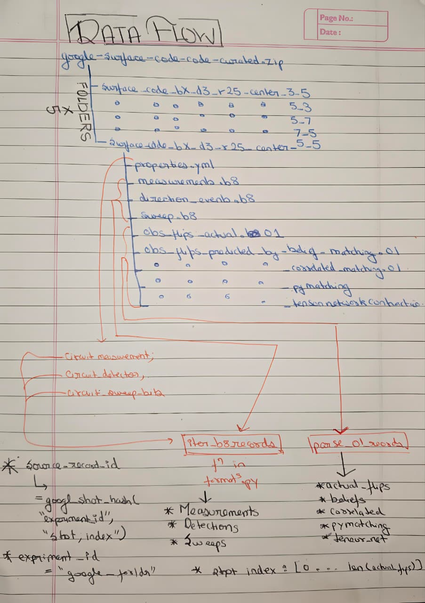

# shot

**Path:** silver/google_qec/shot.parquet

**Owner:** Kartik Agarwal

**Status:** Finished

## Where each column comes from
| Column                                  | Source                                   | Notes                                                                         |
|-----------------------------------------|------------------------------------------|-------------------------------------------------------------------------------|
| `source_record_id`                      | google_shot_81ebcd9698dc                 | google_shot_ + hash(exp_id, shot index)                                       |
| `experiment_id`                         | google_surface_code_bX_d3_r25_center_3_5 | google_FOLDERNAME                                                             |
| `shot_index`                            | int64                                    | shot number in an experiment...can be more than 50000 as well                 |
| `measurement_bits`                      | measurements.b8                          | b8 file + circuit_measuremnt from property.yml                                |
| `sweep_bits`                            | sweep_b8                                 | b8 file + circuit_detectors from property.yml                                 |
| `detector_bits`                         | detection_bits.b8                        | b8 file + circuit_sweep_bits from property.yml                                |
| `detector_event_count`                  | detection_bits.b8                        | count_set_bits(detection_bits)                                                |
| `actual_observable_flip`                | obs_flips_actual.01                      | Respective File                                                               |
| `belief_matching_prediction`            | belief_matching.01                       | Respective File                                                               |
| `correlated_matching_prediction`        | correlate_matching.01                    | Respective File                                                               |
| `pymatching_prediction`                 | pymatching.01                            | Respective File                                                               |
| `tensor_network_contraction_prediction` | tensor_network_contraction_prediction.01 | Respective File                                                               |

## Our understanding of this table

| Column | Type | Meaning |
| --- | --- | --- |
| `source_record_id` | string | Maps from Shared tracing rule |
| `experiment_id` | string | experiment number and links  silver.google_qec.experiment |
| `shot_index` | int64 |  shot number in an experiment...can be more than 50000 as well |
| `measurement_bits` | binary | what did hardware measure |
| `sweep_bits` | binary | Hardware config.  identical measurement bits do not always produce identical detector events if hardware config is dif...hence we need this along with measurement_bits to check sanity of flip|
| `detector_bits` | binary | list like 010101010..0 ..means no flip 1 means..flip |
| `detector_event_count` | int32 | no of flips in detector_bits |
| `actual_observable_flip` | bool | Truth Value |
| `belief_matching_prediction` | bool | Trying to guess Truth Value..can be a wrong guess as well...cant't be trusted |
| `correlated_matching_prediction` | bool | Trying to guess Truth Value..can be a wrong guess as well...cant't be trusted |
| `pymatching_prediction` | bool | Trying to guess Truth Value..can be a wrong guess as well...cant't be trusted |
| `tensor_network_contraction_prediction` | bool | Trying to guess Truth Value..can be a wrong guess as well...cant't be trusted |

## Decisions made
-

## Open questions
-

## Validation checks implemented
- [ ]
