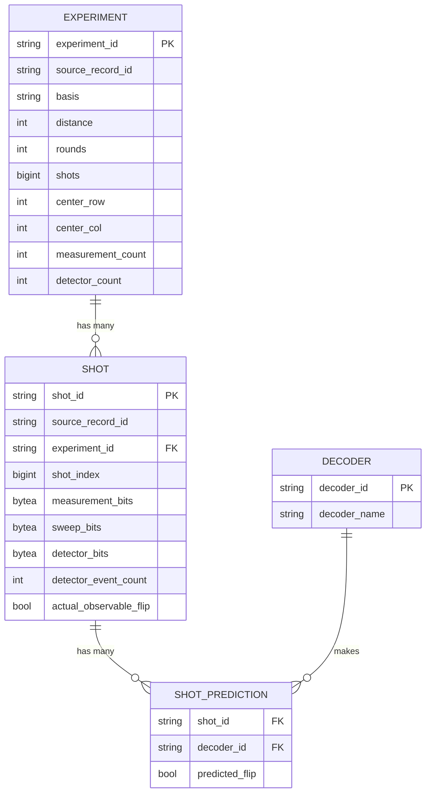
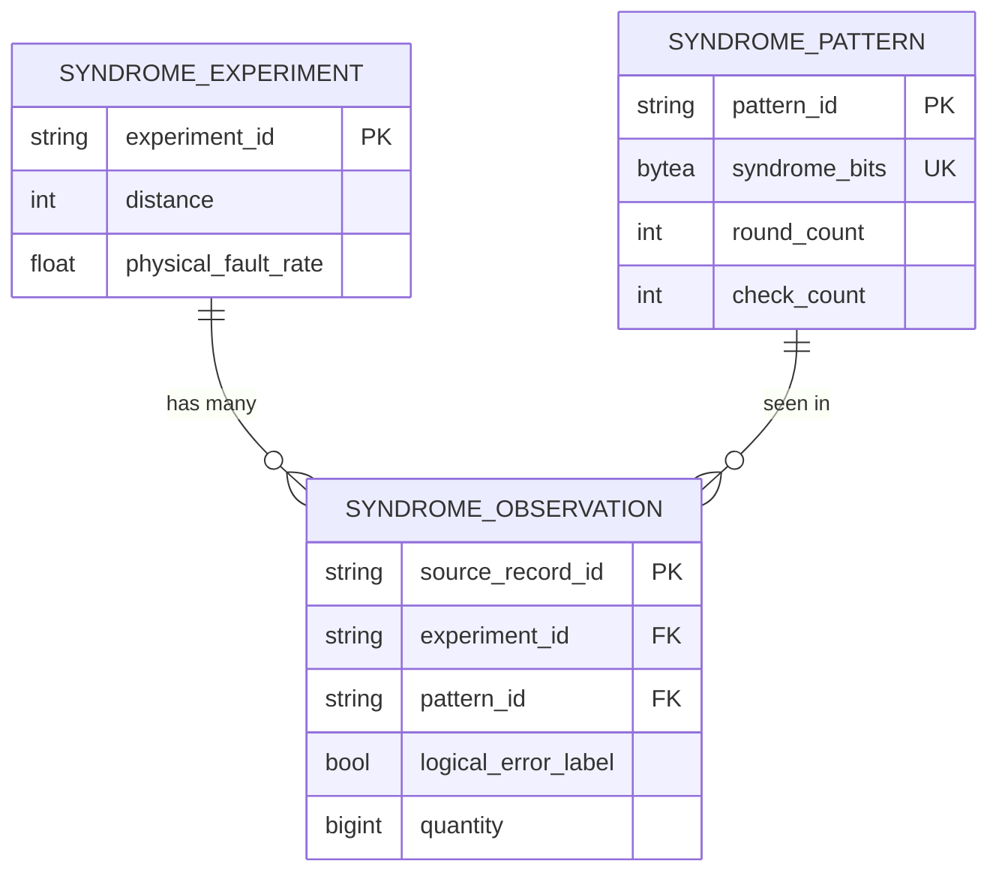

# Group – 7 – DME PROJECT – PART I

# Overview

For our group assignment, we were given three heterogeneous data sources from quantum error correction (QEC). They had different formats, different levels of detail and no shared identifiers. Our job was to understand each source, transform it into clean and readable tables, and organise those tables so they can be analysed further, both with SQL and with machine learning in Part II.

The three sources are:

1.  **Google surface-code data.** Real experimental shots with detector events and the predictions of four decoders.

2.  **Syndrome data.** Simulated syndrome patterns for a distance-3 code at seven physical fault rates.

3.  **QASMBench circuits.** Small quantum circuits written as OpenQASM text.

They use different formats, describe different things and share no identifiers. To turn them into one usable dataset we carried out the following pre-specified tasks:

1.  **Store the raw files safely (Bronze).** We kept the three original zip files unchanged and verified each one by size and SHA-256 hash.

2.  **Understand and clean each source (Silver).** We worked out what a row means in each source, then produced six validated tables in which every row can be traced back to its exact source file and row (or line).

3.  **Design a relational model (Gold).** We decided how the sources relate (and where they do not) and loaded 13 tables into PostgreSQL in a single transaction.

4.  **Analyse the data with SQL**. We answered the three required questions, including one that joins three or more tables.

5.  **Prepare the machine-learning inputs.** We built the two ML tables for Part II from Gold views only.

Altogether we processed \_\_\_\_ rows, and all of them were accepted. The full run from raw files to ML tables and analyses takes about \_\_seconds.

**Work distribution.** The work was split by data source. Kartik and Alex handled the Google and syndrome sources from Bronze through to Gold. Divit, Siddhart and Sahil handled the QASMBench source. For Part II, the split followed the same lines: Divit, Siddhart and Sahil built the models for the syndrome data, and Karthik and Alex built the models for the Google data. Smaller tasks, such as documentation, testing and reviews, were shared out according to each person's workload at the time.

# Sources and what makes each hard

## Data Overview

| **Source**          | **Bronze file**                 | **Size**   | **Content**                                      |
|---------------------|---------------------------------|------------|--------------------------------------------------|
| Google surface code | google-surface-code-curated.zip | 14,638,673 | Experiment detector data and decoder predictions |
| QEC syndromes       | syndromes_dataset.zip           | 358,017    | Syndrome histograms at 7 fault rates             |
| QASMBench           | qasmbench-qec.zip               | 144,172    | 6 circuit files plus a gate library              |

## **Google surface-code source**

The google_surface_code contains of 5 directories, with each individual one having properties.yml, a metadata file corresponding with the google experiment tables for the Silver stage. For each experiment, 50000 shots are performed, summing up to 250000 shots.

Each experiment row is identified by **experiment_id** and a **source_record_id** which links back to its properties.yml file. Every row represent an experiment in a particular chip region (center row/col), how for a particular measurement (basis) and error protection (code distance) measurement cycle was performed for how many runs (shots) And within that shot how many times (rounds) the cycle was performed. it also records the number of raw readout bits per shot (measurement_count) and the final count of detector-event bits per shot (detector_count).

Each experiment has many shots, implying one-to-many relationship used in the Gold schema.

Where the shot table comes from?
Each shot's measurement_bits, sweep_bits and detector_bits are read from the experiment's three .b8 files, detector_event_count is counted from the detector bits, actual_observable_flip and the four decoder predictions each come from their own .01 file, and the IDs (source_record_id, experiment_id) come from a hash of the experiment folder name and shot number.

**The shot table.** Each of the 250,000 shots is one row in `silver/google_qec/shot.parquet`. The hardware readings for a shot are a long string of 0s and 1s, like 0100101.... To save space, the file packs them into bytes, 8 bits per byte. A shot with 13 bits needs 2 bytes, which is 16 bits, so the last 3 bits are filler zeros. Those filler bits aren't real readings. If we read them as real data, the counts come out slightly wrong. So when we unpack the bytes, we keep only the real bits and throw the filler away. 

## **Syndrome source**

*What goes here: What the source contains (7 fault rates, 10M observations each stored as weighted counts), what one row means, and the problem we found (row count is not observation count).*

## **QASMBench source**

- There are 3 benchmarks, each in two variants (source and transpiled), giving 6 circuit files. There is also qelib1.inc, which is the standard gate library and not a circuit.

- The benchmarks are error_correctiond3_n5, qec_en_n5 and qec_sm_n5. All have 5 qubits.

- Only qec_sm_n5 contains classical feedback. It has 3 data qubits, 2 ancilla qubits, a 2-bit syndrome register and 3 conditional X corrections.

- **Problem we found :** the text contains gate definitions (gate syndrome {...}). A definition is not an operation, so counting it would double-count the gates.

# Architecture

*What goes here: How data moves from the raw files to the ML tables, and which code does each step (checklist: architecture and data flow).*

## Pipeline and data flow

*What goes here: The diagram (course data, Bronze, Silver, Gold, ML tables, with the technique on each arrow) plus one sentence per stage.*

The architecture used is aligned with the with the quantum_lake_student stages.
When running the pipeline, everything starts in cli.py. The bronze sources are being fetched from the MinIO, which are being verified (register_sources.py). After the data sources have been verified, the run proceeds to the second and also biggest stage, which implies cleaning and generating silver schema for all three bronze resources. This happens in prepare_data.py, where all the required data is being extracted from the bronze sources, checked for consistency, and appended into the corresponding silver stage table. In addition to that a shared tracing table is generated as well, covering the mapping of every Silver table back to bronze. Upon completion of all the 6 silver tables, the golden schema is getting generated in the load_postgres.py stage, where the tables are being generated (with keys, constraints, and indexes) and filled in with the data from the silver stage. 

# Silver: cleaning, validation, traceability

*What goes here: Show that bad data is handled by clear rules and every row can be traced to its source.*

## Silver tables

*What goes here: The six tables, their source, what one row means and the row counts.*

## Cleaning and validation rules

*What goes here: Reject (error) versus warn (warning), with a few example rules per source. Full rule lists can go in an appendix.*

## Traceability

*What goes here: The source_record_id formats, source_trace.parquet, data_issues.parquet and how a row is followed back to its Bronze file.*

# Gold schema and key decisions

*What goes here: The 13-table PostgreSQL model and the reasons behind it (checklist: ER diagram of the Gold tables, Gold design and key decisions).*

## Gold design by source

### Google

*What goes here: Experiment, shot, decoder and shot_prediction, and why predictions have their own table.*

Since each experiment has a shot related to it, it was decided to connect each individual experiment (google experiment) with its shot (Google shots). The google experiment table is left untouched and its experiment_id is used as FK in the shot table. 

For each shot it is also known what the four decoders have predicted in that particular shot. To prevent redundancy and stimulate clarity, it was decided to give the prediction its own table. This table contains the four decoders. 
The table that connect **decoder** table with **shot** table is the **shot_prediction** table. It uses the shot_id from the **shot** table and decoder_id from the **decoder** table to access each individual prediction for that particular combination of the shot_id and decoder.
This design choice implies a trade-off of an additional join across 2 extra tables instead of writing one row. However, this makes a cross-comparison for decoders far simpler, and in case and additional decoder needs to be added, all the tables (except **decoder**) remain unchanged.

### Syndrome

*What goes here: Experiment, pattern and observation, and why patterns are stored once with the count (weight) on the observation.*

### QASMBench

*What goes here: Circuit, register, qubit, stabilizer check, check-to-data-qubit junction and conditional correction; why the circuit text is split into registers and qubits.*

## ER diagram of the Gold tables

*What goes here: One diagram per source group (or one combined), with primary and foreign keys shown.*

`qec_syndromes` data is stored in three PostgreSQL tables:

- `syndrome_experiment`: one row per noise level (one simulated experiment), with its code distance and physical fault rate.
- `syndrome_pattern`: one row per distinct 16-bit syndrome (4 rounds × 4 checks). Storing each pattern once avoids repeating it in every observation.
- `syndrome_observation`: one row per observation. It links one experiment, one pattern, the logical-error label (yes/no), and `quantity`, the number of simulated shots the row represents.

## Key decisions

*What goes here: A table: decision, reason, alternative not chosen. Include the transaction load, the deterministic ids and the ML views.*

# The rejected relationship

*What goes here: The join between QASMBench and the experiment sources that we tested and rejected: why (circuits versus outputs), the result table from rejected_join_qasmbench.sql (starter/sql/analysis/), and the decision.*

# Data-quality findings

*What goes here: What the checks found, honestly (checklist: quality findings).*

## Row counts

*What goes here: Read, accepted and rejected rows per table from results/part1/row_counts.json, and the total.*

results/part1/row_counts.json reports for the experiment and shot table the read/accepted/rejected row counts. Before that, any corrupted or incomplete experiment folder would be silently accepted. After the fix, any missing or incomplete file is correctly excluded, counted and rejected, which corresponds with the reflected number in row_counts.json. Any discrepancies are written into data_issues.parquet

Here are the overall counts for each of the 6 tables

| Table | Read | Accepted | Rejected |
|---|---|---|---|
| experiment | 5 | 5 | 0 |
| shot | 250,000 | 250,000 | 0 |
| syndrome_observation | 75,598 | 75,598 | 0 |
| circuit | 6 | 6 | 0 |
| stabilizer_check | 4 | 4 | 0 |
| conditional_correction | 6 | 6 | 0 |
| **Gold load (total)** | 325,619 | 325,619 | 0 |

## Warnings and rejected rows

*What goes here: What is in data_issues.parquet (80 warnings: the sx gate and the if keyword) and what they mean.*

## Known gaps

*What goes here: Anything not clean, for example the all-zero-syndrome logical errors and the decoder error rates.*

# Worked traces

*What goes here: Proof that an ML example can be followed back to its source (checklist: the example traces). Use trace_examples.json.*

## Google shot trace

*What goes here: ML row, Gold, Silver, Bronze, with the keys used at each step.*

A trace proves reproducibility, showing that any ML example can be followed back to its original record
An example of the google_experiment trace can be found in trace_examples.json. It is generated by build_trace_examples.py and performs a full ML->Gold->Silver->Bronze trace check.

**ML**: In the ML view, a row is selected, matching the experiment_id and shot_index, giving example_id and shot_id.

**Gold**: gold_shot is being read based on shot_id from the ML stage, which includes source_record_id, linking back to Silver and Bronze stage. The experiment row is read using experiment_id of the shot, which has its own source_record_id. Also, each individual prediction is fetched based on shot_id. 

**Silver**: The experiment and shot parquet tables are being filtered based on the source_record_id from the golden schema of experiment and shot rows. 

**Bronze**: For Bronze, the same source_record_id value is used to find the corresponding rows in the shared source trace table

## Syndrome trace

*What goes here: The same chain for one syndrome row, ending with its Part II predictions.*

An example for syndrome trace can be found in the same file.

**ML**: Based on the physical_fault_rate, we select an example row from ML view, which gives example_id and source_record_id.

**Gold**: For the corresponding source_record_id, the syndrome observation is read which contains pattern_id for the syndrome pattern row. Experiment_id is also used to select the row from the Experiment table.

**Silver & Bronze**: Tables are being filtered on the same source_record_id.

This shows the desired trace, by explicitly extracting the keys and foreign keys.

# SQL analyses

*What goes here: The three required analyses over the Gold tables; at least one must join three or more tables. Outputs are in results/part1/analysis/.*

## Q1: Syndromes by physical fault rate

*What goes here: Question, tables joined, small result table, two-line interpretation.*

## Q2: Decoder error rates

*What goes here: Question, tables joined, result table, interpretation.*

## Q3: Repetition-code circuit mapping

*What goes here: Question, the three-or-more-table join, the checks and corrections tables, interpretation.*

# Limitations

*What goes here: Three or four honest points about where the design or the data stops being reliable.*

# Commands to run

*What goes here: The exact commands, in order: make bootstrap (repo root), then from starter/: make run (pipeline), make train (Part II models), make test (tests). Say what each does.*

# Troubleshooting

*What goes here: Common failures and fixes, and how the tests in starter/tests/ cover the tables (for example test_google_experiment.py).*

# AI usage

*What goes here: Where AI was used and where it was not, in a few sentences.*

AI was mostly used for assistance in the understanding of the assignment. Specifically what each table and source represents, the structure of the data and the flow and requirements from the assignment. 
