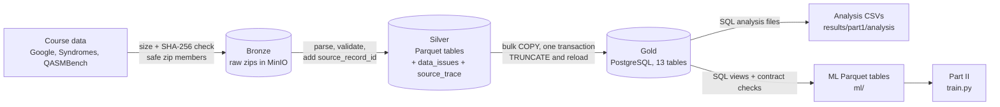
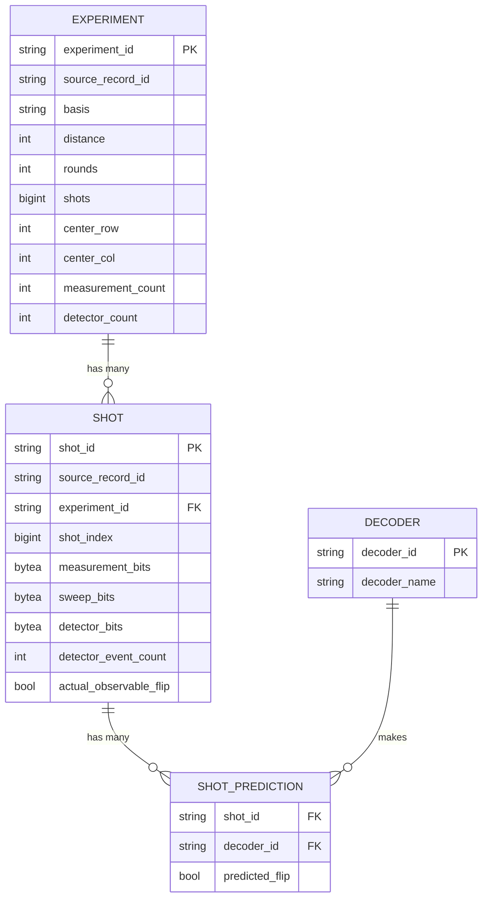
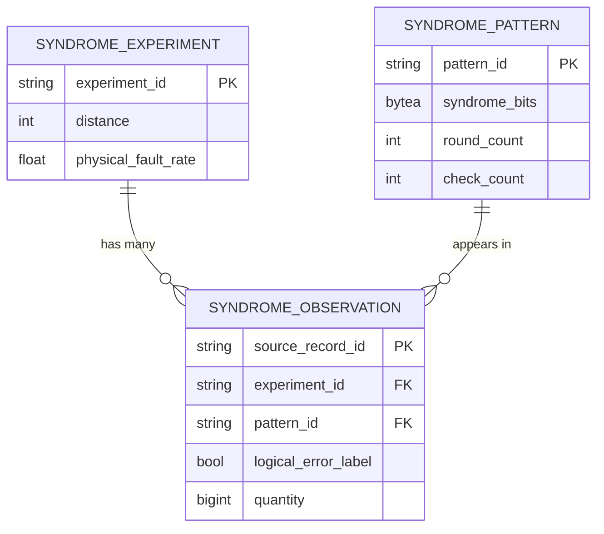
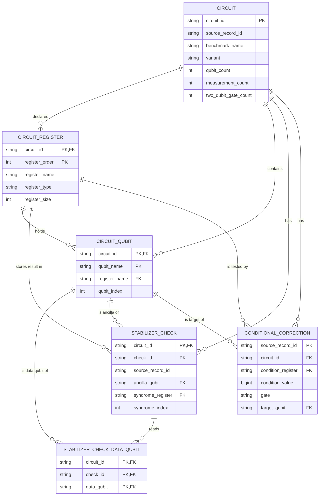

# Group – 7 – DME PROJECT – PART I

# Overview

For our group assignment, we were given three heterogeneous data sources from quantum error correction (QEC). They had different formats, different levels of detail and no shared identifiers. Our job was to understand each source, transform it into clean and readable tables, and organise those tables so they can be analysed further, both with SQL and with machine learning in Part II.

The three sources are:

1.  **Google surface-code data.** Real experimental shots with detector events and the predictions of four decoders.

2.  **Syndrome data.** Simulated syndrome patterns for a distance-3 code at seven physical fault rates.

3.  **QASMBench circuits.** Small quantum circuits written as OpenQASM text.

They use different formats, describe different things and share no identifiers. To turn them into one usable dataset we carried out the following pre-specified tasks:

1.  **Store the raw files safely (Bronze).** We kept the three original zip files unchanged and verified each one by size and SHA-256 hash.

2.  **Understand and clean each source (Silver).** We worked out what a row means in each source, then produced six validated tables in which every row can be traced back to its exact source file and row (or line).

3.  **Design a relational model (Gold).** We decided how the sources relate (and where they do not) and loaded 13 tables into PostgreSQL in a single transaction.

4.  **Analyse the data with SQL**. We answered the three required questions, including one that joins three or more tables.

5.  **Prepare the machine-learning inputs.** We built the two ML tables for Part II from Gold views only.

Altogether we processed 325,619 rows, and all of them were accepted. The full run from raw files to ML tables and analyses takes about 34 seconds.

**Work distribution.** The work was split by data source. Karthik and Alex handled the Google and syndrome sources from Bronze through to Gold. Divit, Siddhart and Sahil handled the QASMBench source. For Part II, the split followed the same lines: Divit, Siddhart and Sahil built the models for the syndrome data, and Karthik and Alex built the models for the Google data. Smaller tasks, such as documentation, testing and reviews, were shared out according to each person's workload at the time.

# Sources and what makes each hard

## Data Overview

| **Source**          | **Bronze file**                 | **Size**   | **Content**                                      |
|---------------------|---------------------------------|------------|--------------------------------------------------|
| Google surface code | google-surface-code-curated.zip | 14,638,673 | Experiment detector data and decoder predictions |
| QEC syndromes       | syndromes_dataset.zip           | 358,017    | Syndrome histograms at 7 fault rates             |
| QASMBench           | qasmbench-qec.zip               | 144,172    | 6 circuit files plus a gate library              |

## **Google surface-code source**

- The Google data contains 5 directories, one for each experiment (4 with code distance 3 and 1 with distance 5). Each directory has a `properties.yml` file with the experiment's metadata, which becomes the `experiment` table in the Silver stage.
- Each experiment row is identified by `experiment_id` and a `source_record_id` that links back to its `properties.yml` file.
- One experiment row describes:
  - the chip region where the experiment was run (`center_row`, `center_col`),
  - the measurement basis (`basis`) and the error-protection level (code distance),
  - the number of runs (`shots`) and the number of times the cycle was repeated within each shot (`rounds`),
  - the number of raw readout bits per shot (`measurement_count`) and the number of detector-event bits per shot (`detector_count`).
- Each experiment has many shots, which gives the one-to-many relationship used in the Gold schema.
- **Problem we found :** the detector events are stored as packed bits (the Stim `b8` format), with 8 bits per byte, the lowest bit first, and zero padding in the last byte. Unpacking them in the wrong order gives wrong values without any error message. Detector events, raw measurements and decoder predictions are also three different things and must not be mixed up. 

## **Syndrome source**

- The syndrome data comes as one zip file with 7 CSV files, one for each physical fault rate (1e-5, 5e-5, 1e-4, 5e-4, 1e-3, 5e-3 and 1e-2). All of them are for code distance 3.
- The file name encodes the experiment, for example `d-3_pfr-0.005000_nb-10M.csv`: code distance 3, physical fault rate 0.005 and 10 million simulated shots (`nb-10M`).
- Each file has three columns: `labels`, `syndromes` and `quantity`.
  - `labels` says whether a logical error occurred.
  - `syndromes` is a text string holding a nested tuple of 4 rounds with 4 binary check values each, which we turn into 16 bits.
  - `quantity` is the number of simulated shots that one row stands for.
- One row is an aggregate: a distinct syndrome pattern with its label and a count. In total the 7 files stand for 70 million shots but contain only 75,598 rows.
- **Problem we found :** the rows are weighted, so the number of rows is not the number of observations. Any rate or average that ignores `quantity` is wrong. We kept `quantity` as a weight (and later as `sample_weight` for the ML tables), and we checked that every file adds up to exactly 10,000,000 observations. We also did not expand the data to 70 million individual rows.

## **QASMBench source**

- There are 3 benchmarks, each in two variants (source and transpiled), giving 6 circuit files. There is also qelib1.inc, which is the standard gate library and not a circuit.
- The benchmarks are error_correctiond3_n5, qec_en_n5 and qec_sm_n5. All have 5 qubits.
- Only qec_sm_n5 contains classical feedback. It has 3 data qubits, 2 ancilla qubits, a 2-bit syndrome register and 3 conditional X corrections.
- **Problem we found :** the text contains gate definitions (gate syndrome {...}). A definition is not an operation, so counting it would double-count the gates.

# Architecture
We used the course architecture without changes: raw files in Bronze, cleaned and validated tables in Silver, a PostgreSQL model in Gold that we designed ourselves, and the ML tables built from Gold for Part II.
## Pipeline and data flow

Our architecture follows the stages of the `quantum_lake_student` package. Everything starts in `cli.py`, where `run_pipeline` calls each stage in order, and `make run` triggers it.

1. **Register (`register_sources.py`).** The three course data sources are checked against the course `bundle-manifest.json` (file size and SHA-256). Unsafe zip members are rejected. Verified files are stored unchanged in the Bronze layer in MinIO.
2. **Prepare (`prepare_data.py`).** Each source is read from Bronze and cleaned, validated and converted into Silver Parquet tables: six tables, plus a shared `data_issues` table and a `source_trace` table. Every Silver row gets a `source_record_id` so it can be traced back to its original file.
3. **Load (`load_postgres.py`).** Once all Silver tables exist, the Gold schema in PostgreSQL is created and filled from Silver. This uses bulk `COPY` inside one transaction, and tables are emptied and reloaded on each run. Gold has 13 tables.
4. **Build ML tables (`build_ml_tables.py`).** SQL views over Gold only are exported as Parquet files in `ml/`. Contract checks run on them before they are written.
5. **Analyse (`analysis.py`).** Every SQL file in `sql/analysis/` is run on Gold and its result is saved as a CSV in `results/part1/analysis/`.

The run ends by writing `run.json` with the row counts, step timings and the git revision. The ML tables are the only input to Part II (`train.py`). A full run takes about 34 seconds.

## Stages, key functions and techniques

| Stage | File | Key functions | What they do / technique used |
|---|---|---|---|
| Orchestrate | `cli.py` | `run_pipeline`, `command_run`, `git_revision` | Runs all stages in order, times each one and records the code revision in `run.json`. |
| Register → Bronze | `register_sources.py` | `load_expected_manifest`, `is_safe_member`, `run` | Compares size and SHA-256 with the course manifest and rejects unsafe zip member paths before storing the raw files. |
| Prepare: Google | `prepare_data.py` | `read_b8_rows`, `padding_is_zero`, `count_set_bits_in_bytes`, `build_experiment_rows`, `build_shot_rows` | Unpacks Stim `b8` bit-packed shots (little-endian), checks padding bits and counts detector bits to produce experiment and shot tables. |
| Prepare: Syndromes | `prepare_data.py` | `parse_filename`, `parse_syndrome_bits`, `build_rows` | Reads metadata from CSV file names, turns the 16-bit syndromes into bit columns and keeps weighted counts instead of expanding to 70M rows. |
| Prepare: QASMBench | `prepare_data.py` | `qasm_statements`, `qasm_registers`, `qasm_gate_definitions`, `qasm_expanded_operations`, `find_stabilizer_checks`, `validate_check`, `build_conditional_correction_rows` | Parses the OpenQASM text, expands gate definitions from `qelib1.inc`, finds stabilizer checks and conditional corrections, and builds circuit tables. |
| Prepare: tracing | `prepare_data.py` | `shot_issue`, `source_trace` rows | Logs problems into `data_issues` and keeps `source_record_id` so every row can be traced back to its source. |
| Load → Gold | `load_postgres.py` | `copy_rows`, `load_experiment`, `load_decoders`, `load_shots`, `load_syndromes`, `load_qasm` | Bulk `COPY FROM STDIN` into 13 Gold tables in one transaction, with `TRUNCATE ... RESTART IDENTITY CASCADE` so reruns give the same result. |
| Build ML tables | `build_ml_tables.py` | `get_google_MlTables`, `get_syndrome_MlTable`, `validate_google_ml_table`, `validate_syndrome_ml_table` | Uses SQL views over Gold only, validates the table contract and writes Parquet to `ml/`. |
| Analyse | `analysis.py` | `run` | Executes every `.sql` file in `sql/analysis/` and writes the results as CSV. |
| Part II helpers | `ml.py`, `train.py` | `unpack_little_endian_bits`, `google_data_split`, `syndrome_data_split`, `weighted_logical_error_rate` | Shared splits and metrics used by the models; these are outside the Part I pipeline. |

# Silver: cleaning, validation, traceability

| Table | Source | One row is | Rows |
|---|---|---|---|
| `google_qec/experiment` | `properties.yml` in each Google experiment folder | One surface-code experiment (basis, distance, rounds, shots, centre qubit) | 5 |
| `google_qec/shot` | The experiment's `.b8` and `.01` files | One shot: its bits, its detector event count, the true observable flip and the four decoder predictions | 250,000 |
| `qec_syndromes/syndrome_observation` | The 7 syndrome CSV files | One syndrome pattern in one file, with how often it was seen (`quantity`) and its logical error label | 75,598 |
| `qasmbench/circuit` | The 6 `.qasm` files | One circuit file (3 benchmarks, source and transpiled) | 6 |
| `qasmbench/stabilizer_check` | The QASM files | One ancilla qubit that is checked by data qubits and then measured into a syndrome bit | 4 |
| `qasmbench/conditional_correction` | The QASM files | One `if` statement that applies a fix depending on the syndrome | 6 |

Together this is 325,619 rows, and none were rejected. Two more tables support these: `source_trace` and `data_issues` (see Traceability).

Some points on the counts:

- **Syndrome rows are weighted.** The 7 files hold about 70 million observations in 75,598 rows. We kept `quantity` instead of expanding the rows as specified.
- **The 4 stabilizer checks and 6 corrections all come from `qec_sm_n5`.** The other benchmarks have no classical feedback.

## Cleaning and validation rules

We use two levels:

- **Error (reject).** The row would be wrong or unusable. It is not written to Silver, and the problem is logged with `action = rejected`.
- **Warning.** The row is usable but something looks odd. It is kept, and the problem is logged with `action = accepted` (or `flagged` for the syndrome total check).

| Source | Check (rule name) | If it fails | Explaination |
|---|---|---|---|
| Google | `google_experiment_properties_present` | Error | Each experiment folder must have a `properties.yml` with all the settings we need (basis, distance, rounds, shots). Without it we can't describe the experiment. |
| Google | `google_shot_file_format` | Error | The data files must be readable. Bit files must split into whole shots, and the prediction files may only contain 0 or 1. |
| Google | `google_shot_companion_lengths` | Error | All the files for an experiment must have the same number of shots (50,000). If they differ, we can't match a shot to its predictions. |
| Google | `google_shot_b8_padding_zero` | Error | Bits are packed 8 per byte, so the last byte can have spare bits. Those spare bits must be 0. If not, the data is probably corrupted. |
| Syndromes | `syndrome_observation_row_check` | Error | Each CSV row needs a valid syndrome (a proper string of bits) and a count above 0. |
| Syndromes | `syndrome_file_total_quantity` | Warning | The counts in a file should add up to the number in its file name (for example 10M for 10 million). If they don't, we log it but still keep the rows. |
| QASMBench | `qasm_circuit_operand_index_in_range` | Error | A circuit can't use a qubit that doesn't exist. If it declares 3 qubits, it can't use `q[7]`. |
| QASMBench | `qasm_cc_condition_value_in_range` | Error | In an `if(syn==3)`, the value must fit the register. A 2-bit register can't be compared to 7. |
| QASMBench | `qasm_circuit_known_gate` | Warning | Every gate used should be one we recognise. An unknown gate looks suspicious, but the circuit may still be fine. |

**Result of the run.** No row was rejected in any table. All 80 issues logged were warnings, all from `qasm_circuit_known_gate`:

- **74 warnings for the gate `sx`.** It appears in the transpiled files (62 in `error_correctiond3_n5_transpiled` and 12 in `qec_en_n5_transpiled`) but is not declared in `qelib1.inc`. The circuits are still correct, so we kept them.
- **6 warnings for `if`.** Three in each `qec_sm_n5` file. Our check treats these `if` statements as gate names, so they are false alarms. We left them in the log instead of hiding them.

The Google and syndrome data raised no issues at all.

**How the rules work.** The assignment lists the checks that must be implemented, such as byte alignment and padding for the Stim `b8` files, positive syndrome counts, and valid QASM registers. We turned each of these into a named rule. The checks run while Silver is being built, inside the functions in `prepare_data.py` that create each table. When a check fails, the code writes a row to `data_issues` with the rule name, the value it saw, the action taken and a reason. If the rule is an Error, the row is left out of Silver. If it is a Warning, the row is kept.

## Traceability

**`source_record_id`.** Every Silver row gets an ID that is built from its source, so the same input always gives the same ID and reruns do not change it.

| Table | Format | Built from |
|---|---|---|
| `experiment` | `exp_<12 hex>` | Hash of `google_<experiment folder name>` |
| `shot` | `google_shot_<12 hex>` | Hash of the experiment ID and the shot number |
| `syndrome_observation` | `syn_<12 hex>` | Hash of the Bronze file, the CSV name and the row number |
| `circuit` | `qasmbench:<file path>` | The path of the `.qasm` file in the archive |
| `stabilizer_check` | `qasmbench:<file path>#L<line>:check=<ancilla>` | The file, the line of the measure, and the ancilla |
| `conditional_correction` | `qasmbench:<file path>#L<line>.<n>` | The file and the position of the `if` statement |

**`source_trace.parquet`** (2,075,625 rows). It links each row to the exact place it came from:

| Column | Meaning |
|---|---|
| `source_record_id` | The ID of the Silver row |
| `source_name` | `google_qec`, `qec_syndromes` or `qasmbench` |
| `bronze_object` | The zip file in Bronze |
| `archive_member` | The file inside the zip |
| `record_locator` | Where in that file: `shot_index=N`, `file.csv:row=N`, a QASM line such as `L17.0`, or `whole_member` |
| `input_sha256` | The SHA-256 of the Bronze zip, so we know which version of the file was used |

There are more trace rows than Silver rows because a row can come from several places. A shot comes from 8 files, so it has 8 trace rows, and a stabilizer check comes from the several QASM lines that build it. In total there are 325,619 distinct `source_record_id` values.

**`data_issues.parquet`** (80 rows). It has one row per problem, with `issue_id`, `source_record_id`, `rule_id`, `severity`, `observed_value`, `action`, `reason` and `run_id`. It tells us what the rule found and what we did about it.

**How to follow a row back.** Take the `source_record_id` of a Gold or ML row and look it up in `source_trace`. For example, the shot `google_shot_1ecd33282285` points to:

- the Bronze object `bronze/source=google_qec/google-surface-code-curated.zip`,
- the member `surface_code_bX_d3_r25_center_5_7/obs_flips_predicted_by_belief_matching.01`,
- the locator `shot_index=49997`.

The `input_sha256` can be compared with the hash saved for that zip in `run.json`, which also records the run ID and the code revision.

# Gold schema and key decisions

## Gold design by source

### Google

Since each experiment has a shot related to it, it was decided to connect each individual experiment (google experiment) with its shot (Google shots). The google experiment table is left untouched and its experiment_id is used as FK in the shot table.

For each shot it is also known what the four decoders have predicted in that particular shot. To prevent redundancy and stimulate clarity, it was decided to give the prediction its own table. This table contains the four decoders. The table that connect decoder table with shot table is the shot_prediction table. It uses the shot_id from the shot table and decoder_id from the decoder table to access each individual prediction for that particular combination of the shot_id and decoder. This design choice implies a trade-off of an additional join across 2 extra tables instead of writing one row. However, this makes a cross-comparison for decoders far simpler, and in case and additional decoder needs to be added, all the tables (except decoder) remain unchanged.

Each Google table has a clear meaning for one row, and the database enforces it with keys and checks:

| Table | One row is | Key and constraints |
|---|---|---|
| `experiment` | One surface-code experiment | Primary key `experiment_id`. `source_record_id` is unique. `basis` must be `X` or `Z`, and `distance`, `rounds` and `shots` must be above 0. |
| `shot` | One hardware shot in one experiment, with its packed bits and the true observable flip | Primary key `shot_id`. Foreign key `experiment_id` points to `experiment`. The pair (`experiment_id`, `shot_index`) is unique, so a shot cannot be stored twice. |
| `decoder` | One of the four supplied decoders | Primary key `decoder_id`. `decoder_name` is unique. |
| `shot_prediction` | What one decoder predicted for one shot | Primary key (`shot_id`, `decoder_id`), so each decoder has exactly one prediction per shot. Both columns are foreign keys. |

Two indexes support the common queries: `shot(experiment_id)`, for reading all the shots of an experiment, and `shot_prediction(decoder_id)`, for comparing decoders. Together with the keys, these make the decoder comparison in Q2 a plain join.

#### How the shot bits are stored

Each shot has hundreds of bits: for distance 3, 200 detector bits and 209 measurement bits. We did not store these as one database row per bit. That would need at least 40 million rows for the four distance-3 experiments alone (200,000 shots × 200 detectors). Instead, `shot` keeps each shot as one row, and the bits stay packed in `bytea` columns (`measurement_bits`, `sweep_bits`, `detector_bits`), the same way the source file stores them. The count of set detector bits is also kept in `detector_event_count`, so common questions do not need to unpack anything.

The `shot` table takes up 106 MB in PostgreSQL for 250,000 shots (measured with `pg_total_relation_size('shot')`, including indexes), which is about 440 bytes per shot.

Packing loses no information. The ML export unpacks the bytes in little-endian order and drops the unused padding bits. This is checked by `test_unpack_little_endian_bits_discards_padding` in `test_ml.py`, and the export reads only from Gold, never from Bronze or Silver.

### Syndrome

The syndrome data is stored in three tables, one for the experiments, one for the distinct syndrome patterns and one for the observations that connect them.

- **syndrome_experiment** has one row per experiment, which means one per CSV file (7 rows). It stores the code distance and the physical fault rate, which are read from the file name. The distance is stored here once, so it does not repeat on every observation.
- **syndrome_pattern** has one row per distinct 16-bit syndrome. The bits are stored as 16 bytes of 0 and 1 and must be unique, and the round count and check count are both checked to be 4. The `pattern_id` is a hash of the bits (`pat_` followed by 12 hexadecimal characters), so the same syndrome always gets the same id.
- **syndrome_observation** has one row per row of the source CSV (75,598 rows). It points to its experiment and its pattern, and stores the logical-error label and the `quantity`, which is the number of simulated shots the row stands for. Its key is the `source_record_id`, so every observation traces back to a file and row.

We store the pattern once and keep the label and the count on the observation, for three reasons:

- The same syndrome occurs many times. In the analysis query Q1 there are 75,598 rows but only 50,439 distinct (experiment, pattern) combinations, so some syndromes occur in more than one row of the same experiment, with different labels. The label therefore belongs to the observation, not to the pattern.
- The `quantity` has to stay on the observation, because the same pattern has a different count for each experiment and label. Keeping it there makes weighted sums a simple `SUM(quantity)`.
- Storing the bits once saves space and lets analyses group by pattern directly.

The price is one extra table and two joins whenever we need the bits together with the label. In return, the database prevents impossible values: a quantity must be positive, a pattern must have exactly 4 rounds and 4 checks, and an observation cannot point to an experiment or a pattern that does not exist.

### QASMBench

The QASMBench tables form their own group in Gold. They are linked to each other by `circuit_id`, which has the form `qasmbench:<benchmark>:<variant>`, and have no foreign key to the Google or syndrome tables (see the rejected relationship section).

The central table is **circuit**. It holds one row per circuit file (6 rows: 3 benchmarks, each in a `source` and a `transpiled` variant), with the qubit, measurement and two-qubit gate counts. A check constraint only allows the variants `source` and `transpiled`, and the pair (`benchmark_name`, `variant`) must be unique.

The Silver `circuit` table stores the registers as text (for example `qreg q[3]; qreg a[2]`). In Gold this text is split into two tables:

- **circuit_register** has one row per declared register (`q`, `a`, `c`, `syn`) with its type (`qreg` or `creg`), size and declaration order.
- **circuit_qubit** has one row per individual qubit (`q[0]`, `q[1]`, `a[0]`, ...). Only quantum registers create qubit rows.

These two tables let the database check the other tables. An ancilla, a data qubit or a correction target cannot be stored unless that qubit exists in the same circuit, and a syndrome or condition register cannot be named unless it is declared.

The **stabilizer_check** table has one row per parity check. It stores the ancilla qubit that does the check, plus the classical register and index where its result is written. Silver stores this as one text value (`syn[0]`). Gold splits it into `syndrome_register` and `syndrome_index`, because the analysis query needs the index as a number.

A check reads from one or more data qubits. A list in one column could not be joined or constrained, so they go in their own junction table, **stabilizer_check_data_qubit**, with one row per (check, data qubit).

The **conditional_correction** table has one row per `if(register == value) gate target` statement. Its condition register and its target qubit are foreign keys into `circuit_register` and `circuit_qubit`, so a correction can only point at things that exist in its circuit.

Design choices:

- This adds extra tables and joins compared with one wide circuit table. In return, the database enforces consistency, and the query "which data qubits feed which check, and which correction repairs them" is a plain join.
- Source and transpiled circuits are both kept, because they are separate files with different statements. Merging them would break the link back to the exact file.
- The value `syn == 0` has no correction row. No check fired, so there is nothing to repair.

## ER diagram of the Gold tables

### Gold Design

### Syndrome

### QASMBench 

## Key decisions
**Google**

- **Predictions in their own tables.** The four decoder predictions go in `decoder` and `shot_prediction`, with one row per shot and decoder, and not as four columns in `shot`. *Why:* comparing decoders becomes a simple group-by, and a fifth decoder would only need a new row in `decoder`.
- **Bits stay packed.** Each shot is one row, and its bits stay packed in `bytea` columns. *Why:* one row per bit would need about 70 million rows, and the packed bytes can be unpacked exactly.
- **Reject at the right level.** A shot with non-zero padding bits is rejected on its own. If an experiment's files do not all have the declared number of shots, all of that experiment's shots are rejected. *Why:* one bad shot does not make the others wrong, but misaligned files mean no shot can be matched with its predictions.
- **Stable IDs from the source.** A shot ID is a hash of the experiment and the shot number. *Why:* the same input always gives the same ID, so reruns add no duplicates.

**Syndromes**

- **Keep the weighted rows.** We keep the 75,598 aggregate rows with their `quantity` and do not expand them to 70 million. *Why:* the assignment says not to, and every rate is then a weighted sum.
- **Pattern stored once, label on the observation.** The bits live in `syndrome_pattern`, and the label and weight live in `syndrome_observation`. *Why:* the same pattern appears with both labels in the same experiment, so the label belongs to the observation, not to the pattern.
- **Fixed bit order.** The syndrome is stored as 16 bits ordered by round and then by check. *Why:* this is the order the assignment fixes for the ML table, so the bits can be used without reordering.
- 
**QASMBench**

- **Keep all 6 circuits.** Every file has a row in `circuit`. *Why:* the circuit table only describes what is in each file, and every file does have that. Dropping the others would lose information, and the files with no checks or corrections are still useful to show.
- **Conditional corrections only where they exist.** Only `qec_sm_n5` has `if` statements (3 per variant, 6 in total), so the other benchmarks have no rows in that table. *Why:* an `if` statement is what makes a correction, so we only add a row when the file has one. Adding empty rows for the other circuits would be made-up data.
- **Keep source and transpiled separate.** *Why:* they give the same counts, but they are different files with different code. Keeping both lets every row point back to its own file, and we can check that the two versions agree.

# ML input tables

Part II reads two Parquet tables that Part I produces. We build their content with SQL views over Gold only and never re-read Bronze or Silver. A small Python step (`build_ml_tables.py`) runs the views, adds the course split, checks the result and writes the Parquet files to `ml/`. Together they hold 325,598 rows (250,000 + 75,598).

| Table | One row is | Rows |
|---|---|---|
| `ml_google_decoder_example` | One Google hardware shot, with its packed detector bits, the four decoder predictions and the true observable flip | 250,000 |
| `ml_syndrome_decoder_example` | One distinct syndrome-and-label observation in one fault-rate experiment, with its weight (`sample_weight`, the source `quantity`) | 75,598 |

**`example_id`.** Every ML row has an `example_id`, a repeatable hash (for example `ml_f1d5fd50f9b1`), so reruns give the same IDs. It leads back to the Gold record (`shot` or `syndrome_observation`), then to Silver and Bronze (see the worked traces).

**Splits.** The course fixes the splits so all teams can be compared:

- Google: odd `shot_index` is test (50%), even `shot_index` with `shot_index % 10 == 8` is validation (10%), and the remaining even shots are train (40%).
- Syndromes: fault rate 0.0005 is validation, 0.005 is test, and the other five fault rates are train.

**Checks.** Before writing, the code checks that `example_id` is unique, that all three splits have rows, that every syndrome has 16 binary values, that the packed detector bytes have the right length with zero padding, and that `detector_event_count` equals the number of set bits.

# The rejected relationship

QASMBench is different in kind from the other two sources. A QASMBench file is a **circuit**: a description of the operations a quantum computer should run. The Google and syndrome files are **outputs**: measurements and results from running experiments. A circuit has no shots, no syndromes and no error labels, so drawing a relationship between the two kinds of data has no real meaning.

We still tested it rather than assuming. The query `starter/sql/analysis/rejected_join_qasmbench.sql` tries several ways of joining the circuits to the experiments, and its output is saved in `starter/results/part1/analysis/rejected_join_qasmbench.csv`:

| Candidate join | Matching rows |
|---|---|
| Circuit id = Google experiment id | 0 |
| Circuit id = syndrome experiment id | 0 |
| Measurement count, qubit count or checks per circuit = the Google values | 0 |
| Benchmark name contains `d3`, joined to syndrome rows | 151,196 |
| Benchmark name contains `d3`, joined to Google shots | 400,000 |

Every join based on a real identifier or property finds nothing. The only one that returns rows matches on the text "d3" in a benchmark name. Here "d3" is read as code distance 3, and only one benchmark (`error_correctiond3_n5`, in its source and transpiled variants) has it. That one match pairs the same two circuit files with every distance-3 row, so the numbers are large but meaningless, and any totals computed over them would be wrong.

**Decision.** QASMBench stays in its own tables, linked to each other by `circuit_id`, with no foreign key to either experiment source. The decision is also recorded in `docs/Decisions.md`.

# Data-quality findings

## Overall

All three sources passed validation without a single rejected row. In total 325,619 rows were read and 325,619 were accepted.

| Table | Source | Read | Accepted | Rejected |
|---|---|---|---|---|
| `experiment` | Google | 5 | 5 | 0 |
| `shot` | Google | 250,000 | 250,000 | 0 |
| `syndrome_observation` | Syndromes | 75,598 | 75,598 | 0 |
| `circuit` | QASMBench | 6 | 6 | 0 |
| `conditional_correction` | QASMBench | 6 | 6 | 0 |
| `stabilizer_check` | QASMBench | 4 | 4 | 0 |
| **Total** | | **325,619** | **325,619** | **0** |

The counts come from `results/part1/row_counts.json`. The `data_issues` table holds 80 warnings, and all of them come from QASMBench (see below). The rest of this section describes the findings for each source.

## Google

All 5 experiments and all 250,000 shots were accepted, and the Google data raised no issues. We checked, for every experiment and shot:

- **Companion files line up.** The measurement, detector and sweep files and the five `.01` files (the true flips and the four decoder predictions) all hold the declared 50,000 shots per experiment.
- **Padding bits are zero.** Bits are packed 8 per byte, and the unused bits at the end of each record were zero in every shot.
- **Values are binary.** The `.01` files contained only 0 and 1.

## Syndromes

All 7 files and all 75,598 rows were accepted, and the syndrome data raised no issues.

- **Header differs from the documentation.** The README documents a column called `label`, but the files have `labels`. Our reader expects `labels`, and stops with an error if the header is anything else, so a changed header cannot slip through unnoticed.
- **Shape.** Every syndrome is 4 rounds of 4 binary check values, which we turn into 16 bits.
- **Weights.** Every `quantity` is positive (the smallest is 1).
- **Totals.** Each file adds up to exactly 10,000,000 weighted observations, so the total-quantity warning never fired.
- **Same syndrome, both labels.** The same syndrome can appear with label 0 and with label 1 in the same file. This is valid, because the same measurement can end with and without a logical error. Across the files this happens for 25,159 syndromes, and we kept all of them. It is also why there are 75,598 rows but only 50,439 distinct (experiment, pattern) combinations.

## QASMBench

### Row counts

All QASMBench rows passed validation: nothing was rejected.

| Table | Read | Accepted | Rejected |
|---|---|---|---|
| `circuit` | 6 | 6 | 0 |
| `conditional_correction` | 6 | 6 | 0 |
| `stabilizer_check` | 4 | 4 | 0 |

Only two of the six circuit files produce rows in `conditional_correction` and `stabilizer_check`: the source and transpiled versions of `qec_sm_n5`. This is the only benchmark with classical feedback. The other four files (`error_correctiond3_n5` and `qec_en_n5`, each in two variants) contain no `if` statements and no parity checks, so they correctly produce a `circuit` row and nothing else. These empty results are not data loss.

| File | `circuit` | `conditional_correction` | `stabilizer_check` |
|---|---|---|---|
| `error_correctiond3_n5` (source, transpiled) | 1 each | 0 | 0 |
| `qec_en_n5` (source, transpiled) | 1 each | 0 | 0 |
| `qec_sm_n5` (source, transpiled) | 1 each | 3 each | 2 each |

We checked the counts against the raw files. A text scan of the whole archive finds `if(` on exactly 6 lines, which matches the 6 rows in `conditional_correction`. The 4 stabilizer checks are the 2 parity checks of `qec_sm_n5`, counted once per variant. Source and transpiled files also give the same qubit, measurement and two-qubit gate counts for every benchmark, which is a useful consistency check because transpiling changes how gates are written, not how many there are.

### Warnings and rejected rows

No QASMBench row was rejected, but `data_issues` contains 80 warnings. All of them come from one rule, `qasm_circuit_known_gate`, which warns when a gate name is not defined in the circuit or in the gate library `qelib1.inc`.

| File | Warnings | Gate name flagged | Meaning |
|---|---|---|---|
| `error_correctiond3_n5_transpiled` | 62 | `sx` | Real finding |
| `qec_en_n5_transpiled` | 12 | `sx` | Real finding |
| `qec_sm_n5` and `qec_sm_n5_transpiled` | 3 each (6 in total) | `if` | Probably a false positive |

- **`sx` (74 warnings):** this gate appears only in the transpiled files. The transpiler introduced it, and `qelib1.inc` does not declare it. We accepted these rows because an unknown gate name is more likely a gap in our gate list than a broken circuit. This is why the rule is a warning and not an error.
- **`if` (6 warnings):** `if` is the keyword for a conditional statement, not a gate. The count is 3 per file, which equals the number of conditional statements in each file, so the rule is most likely treating each `if` statement as a gate. These rows are correct and also appear in `conditional_correction`.

Each validation rule is also tested with a crafted bad input in `tests/test_qasmbench.py`. This shows that the rules work even though none of them rejected a real row.

### Known gaps

- The rule `qasm_circuit_known_gate` does not recognise the `if` statement, so it produces 6 warnings that are not real problems.
- `run.json` reports `issue_count: 0` for every stage, while `data_issues.parquet` holds 80 warnings. The counter only counts rejections, not warnings.
- Only one of the three benchmarks contains classical feedback, so the correction and check logic has been checked on a single circuit family.

# Worked traces

## Google shot trace

A trace proves reproducibility: it shows that any ML example can be followed back to its original record. An example of the Google trace can be found in `results/part1/trace_examples.json`. It is generated by `build_trace_examples.py` and builds the full chain ML, Gold, Silver and Bronze for one shot (experiment `google_surface_code_bX_d3_r25_center_3_5`, shot index 1).

- **ML:** a row is selected from the ML view by `experiment_id` and `shot_index`. This gives the `example_id` (`ml_f1d5fd50f9b1`) and the `shot_id` (`google_shot_4959c10c62f4`).
- **Gold:** the `shot` table is read by `shot_id`. It contains a `source_record_id` that links back to Silver and Bronze. The `experiment` row is read using the shot's `experiment_id` and has its own `source_record_id` (`exp_dc1c8c81dc52`). The four decoder predictions are read from `shot_prediction` by `shot_id`.
- **Silver:** the `shot` and `experiment` Parquet tables are filtered by the `source_record_id` values taken from the Gold shot and experiment rows.
- **Bronze:** the same `source_record_id` values are used to find the rows in the shared source trace table. One shot maps to several files in the original archive, each with the record locator `shot_index=1`: the measurements, the detection events, the actual observable flips and the predictions of each decoder.

| Step | Table or file | Key used |
|---|---|---|
| ML | `ml/ml_google_decoder_example.parquet` | `example_id` = `ml_f1d5fd50f9b1` |
| Gold | `shot`, `experiment`, `shot_prediction` | `shot_id` = `google_shot_4959c10c62f4`, `experiment_id` |
| Silver | `silver/google_qec/shot.parquet` and `experiment.parquet` | `source_record_id` |
| Bronze | `source_trace.parquet` | `source_record_id`, archive member and `shot_index=1` |

## Syndrome trace

An example for the syndrome trace can be found in the same file.

- **ML:** an example row is selected from the ML view using the `physical_fault_rate` (0.005). This gives the `example_id` (`0001d337430c71924ebbea40f16c760d`) and the `source_record_id` (`syn_e0e8e6490262`).
- **Gold:** for this `source_record_id`, the `syndrome_observation` row is read. It contains the `pattern_id` (`pat_8a401b2b5886`), which is used to read the `syndrome_pattern` row. The `experiment_id` (`syndrome_d3_pfr0.005`) is used to read the `syndrome_experiment` row.
- **Silver and Bronze:** the Silver table `syndrome_observation` and the source trace table are filtered on the same `source_record_id`. The Bronze row points to the archive member `d-3_pfr-0.005000_nb-10M.csv`, row 18075.

This shows the trace by explicitly extracting the keys and foreign keys at every step.

# SQL analyses

The assignment asks three questions, which we answer with reproducible SQL against the Gold tables. The queries are in `starter/sql/analysis/`, and the analysis stage runs them and saves each result as a CSV file in `starter/results/part1/analysis/`. 

## Q1: How do weighted syndrome frequency and logical-error labels change with physical fault rate?

**Query:** `q1_syndrome_by_fault_rate.sql`. It joins `syndrome_observation`, `syndrome_experiment` and `syndrome_pattern` (three Gold tables), groups by experiment, and weights every row by its `quantity` so that each row counts as many times as it was observed.

| Fault rate | CSV rows | Distinct syndromes | Weighted observations | Logical-error rate | Share of all-zero syndrome | Logical errors with all-zero syndrome |
|---|---|---|---|---|---|---|
| 1e-5 | 68 | 68 | 10,000,000 | 0.000234 | 0.99873 | 0 |
| 5e-5 | 215 | 202 | 10,000,000 | 0.001154 | 0.99364 | 0 |
| 1e-4 | 491 | 445 | 10,000,000 | 0.002291 | 0.98741 | 0 |
| 5e-4 | 1,407 | 1,228 | 10,000,000 | 0.011440 | 0.93841 | 2 |
| 1e-3 | 2,854 | 2,387 | 10,000,000 | 0.022702 | 0.88061 | 2 |
| 5e-3 | 20,887 | 14,643 | 10,000,000 | 0.103950 | 0.53097 | 210 |
| 1e-2 | 49,676 | 31,466 | 10,000,000 | 0.186527 | 0.28396 | 1,010 |

**What it shows:**

- The weighted logical-error rate rises steadily with the physical fault rate, from 0.0234% at 1e-5 to 18.7% at 1e-2. At low fault rates it is about 23 times the fault rate (0.000234 / 0.00001 = 23.4; 0.0227 / 0.001 = 22.7). At 1e-2 the ratio drops to about 18.7, so the rise slows at higher fault rates.
- The share of observations with the all-zero syndrome falls from 99.9% to 28%, so a rising fault rate goes together with more non-trivial syndromes.
- The number of distinct syndromes grows from 68 to 31,466. This is why the data are stored as weighted rows and why the Gold design keeps each pattern once.
- A few logical errors occur with an all-zero syndrome (2 at 5e-4, up to 1,010 rows at 1e-2). The 16 syndrome bits cannot reveal these errors.
- Each file adds up to exactly 10,000,000 weighted observations, which confirms the weights are handled correctly.
- Only distance 3 is available for the syndrome data, so this comparison says nothing about different code distances.

## Q2: How do the supplied decoder logical-error rates compare by code distance and distance-three processor location?

**Query:** `q2_decoder_error_rates.sql`. It joins `shot`, `experiment` and `shot_prediction` (three Gold tables) and groups by distance, patch centre and decoder. A decoder is counted as wrong on a shot when its predicted flip differs from the actual observable flip. The error rate is the share of shots where it is wrong.

| Distance | Patch centre | Belief matching | Correlated matching | PyMatching | Tensor-network contraction |
|---|---|---|---|---|---|
| 3 | (3, 5) | 0.4025 | 0.4194 | 0.4342 | 0.4023 |
| 3 | (5, 3) | 0.4159 | 0.4252 | 0.4432 | 0.4130 |
| 3 | (5, 7) | 0.3920 | 0.4182 | 0.4306 | 0.3839 |
| 3 | (7, 5) | 0.3884 | 0.4130 | 0.4299 | 0.3887 |
| 5 | (5, 5) | 0.4015 | 0.4257 | 0.4510 | 0.3955 |

Every row covers 50,000 shots per decoder.

**What it shows:**

- The order of the decoders is the same in all five experiments. Tensor-network contraction and belief matching have the lowest error rates (within about one percentage point of each other), correlated matching comes next, and PyMatching has the highest.
- All four decoders disagree with the actual observable flip on roughly 38% to 45% of shots, so they are only moderately better than guessing.
- Among the four distance-3 locations, the error rates differ by up to about three percentage points for the same decoder (for example 0.388 to 0.416 for belief matching).
- The distance-5 experiment does not show lower error rates than the distance-3 experiments (0.3955 to 0.4510 against 0.3839 to 0.4432). In this data, a larger distance is not associated with a lower decoder error rate.
- Only one distance-5 location is available, so the distance comparison rests on a single experiment.

## Q3: How does the repetition-code circuit map data qubits to parity-check ancillas, syndrome bits and conditional corrections?

**Queries:** `q3a_parity_checks.sql` and `q3b_conditional_corrections.sql`. Q3a joins `circuit`, `stabilizer_check` and `stabilizer_check_data_qubit` (three Gold tables). Q3b joins `conditional_correction`, `circuit` and `stabilizer_check` (also three tables). Only `qec_sm_n5` contains parity checks and corrections, so both queries return rows for this one benchmark.

**Q3a: parity checks**

| Variant | Check | Ancilla | Data qubits | Syndrome bit |
|---|---|---|---|---|
| source | `a[0]` | `a[0]` | `q[0]`, `q[1]` | `syn[0]` |
| source | `a[1]` | `a[1]` | `q[1]`, `q[2]` | `syn[1]` |
| transpiled | `a[0]` | `a[0]` | `q[0]`, `q[1]` | `syn[0]` |
| transpiled | `a[1]` | `a[1]` | `q[1]`, `q[2]` | `syn[1]` |

**Q3b: conditional corrections**

| Variant | Condition | Checks that fired | Gate | Target qubit |
|---|---|---|---|---|
| source | `syn == 1` | `a[0]` | `x` | `q[0]` |
| source | `syn == 2` | `a[1]` | `x` | `q[2]` |
| source | `syn == 3` | `a[0]`, `a[1]` | `x` | `q[1]` |
| transpiled | `syn == 1` | `a[0]` | `x` | `q[0]` |
| transpiled | `syn == 2` | `a[1]` | `x` | `q[2]` |
| transpiled | `syn == 3` | `a[0]`, `a[1]` | `x` | `q[1]` |

The "checks that fired" column is derived in SQL. The classical register `syn` is read as a binary number in which syndrome bit 0 is worth 1 and bit 1 is worth 2. A check fired when its bit is set in the condition value, which the query tests with `(condition_value >> syndrome_index) % 2 = 1`.

**What it shows:**

- This circuit is a repetition code on three data qubits (`q[0]`, `q[1]`, `q[2]`) with two ancilla qubits. The ancilla `a[0]` compares `q[0]` with `q[1]`, and `a[1]` compares `q[1]` with `q[2]`. Their measurement results are stored in `syn[0]` and `syn[1]`.
- Each correction matches the pattern of checks that fired. If only `a[0]` fires, `q[0]` is the only qubit that only that check reads, so the circuit flips `q[0]`. If only `a[1]` fires, it flips `q[2]`. If both fire, `q[1]` is the qubit both checks read, so it flips `q[1]`.
- The value `syn == 0` has no correction: no check fired, so there is nothing to repair.
- The source and transpiled variants return identical results, so transpiling did not change the logic.

# Limitations

- **QASMBench has no results.** The six QASMBench files only describe circuits. They have no measured outcomes, so we could not link them to the Google or syndrome data. Only `qec_sm_n5` has classical feedback, so only 2 of the 6 files gave useful output.
- **Syndrome data is stored in groups.** The 70 million observations come as 75,598 weighted rows. We kept them grouped (as specified), so we cannot see individual observations, and any rate we calculate has to use the weights.
- **Google data is small.** There are only 5 experiments, and just one is at distance 5. So comparing distances only gives a rough idea.
- **Some warnings are false alarms.** The gate check logs 80 warnings. 74 are for the gate `sx`, which is real but not listed in `qelib1.inc`. The other 6 come from `if` statements that the check mistakes for gates. The data is not affected, but the warning count is higher than the real number of problems.

# Commands to run

Run these in order.

| Where | Command | What it does |
|---|---|---|
| Repo root | `make bootstrap` | Starts PostgreSQL, MinIO, Adminer and JupyterLab, copies the course data into Bronze, and checks that everything is ready. |
| `starter/` | `make run` | Runs the whole pipeline: checks and stores the source files (Bronze), builds the Silver tables, loads Gold into PostgreSQL, builds the ML tables and runs the SQL analyses. It takes about 34 seconds. Results go to `results/part1/`. |
| `starter/` | `make train` | Trains and evaluates the Part II models from the ML tables. Results go to `results/part2/`. |
| `starter/` | `make test` | Runs the automated tests. |

Two extra commands are useful when something looks wrong: `make check` (are PostgreSQL and MinIO reachable?) and `make inventory` (are the course data files there?).

# Troubleshooting

## What can go wrong when running the pipeline

| Problem | Why it happens | What to do |
|---|---|---|
| `make run` or `make train` cannot connect | PostgreSQL or MinIO is not running, because `make bootstrap` was not run or the services were stopped | Run `make bootstrap` at the repo root, then `make check` in `starter/` to confirm both are reachable |
| `python: command not found` | The `starter/` Makefile calls `python`, and some systems only have `python3` | Run `make run PYTHON=python3` (the same works for `train` and `test`) |
| `make train` fails because ML tables are missing | Part II reads the tables that `make run` creates, so it was run first | Run `make run`, then `make train` |
| The run stops at the start with a hash or size error | A source zip does not match the course `bundle-manifest.json`, so it was changed or is incomplete | Re-copy the original course data (`make seed` at the repo root, or `make inventory` to see what is there). The check is on purpose, because we must not process unverified data. |
| The run stops with an error about a missing file or an unsafe name | A required companion file is missing, or a zip member has an unsafe path | This is on purpose. The assignment says these cases must stop the run. Fix the input data and rerun. |
| Row counts do not match the report | The data or the code revision changed | Compare `results/part1/row_counts.json` and `run.json`, which record the counts, the input hashes and the code revision of each run |
| `data_issues.parquet` contains 80 warnings | These are expected: 74 for the gate `sx` and 6 for `if` statements (see Cleaning and validation rules) | No action needed. No rows are rejected. |
| Old data in PostgreSQL | An earlier run left rows behind | Rerunning is safe. Gold is emptied and reloaded on every run. For a completely fresh start, `make reset-platform` removes the containers and their data, then run `make bootstrap` again. |

## How the tests cover the tables

The tests in `starter/tests/` build small made-up inputs and run offline, so they need no database or MinIO.

| Test file | What it covers |
|---|---|
| `test_google_experiment.py` | The Google `experiment` table: valid folders, column types, the ID format, a trace row back to Bronze, and rejection of missing or incomplete `properties.yml` |
| `test_google_shot.py` | The Google `shot` table: valid shots are published, non-zero padding rejects only that shot, a length mismatch rejects the experiment's shots, and a missing companion file stops the run |
| `test_formats.py` | The `.b8` and `.01` readers: byte alignment, little-endian bit order, partial records and non-binary values |
| `test_qasmbench.py` | The QASMBench tables: gate expansion, register reading, line locators, stable IDs, and rejected versus warned rules |
| `test_ml.py` | The Part II helpers: unpacking bits, train/test splits and weighted error rates |
| `test_models.py`, `test_config.py` | Record hashing, stage results and settings |

# AI usage

We used an AI assistant as a helper while working on the assignment. It did not replace our own work on the pipeline or the analysis.

- **Understanding the assignment.** We used it to explain what each table and data source represents, how the data is structured, and what the assignment requires at each stage.
- **Background on quantum computing.** We used it to learn the basics of quantum error correction, such as what syndromes, stabilizer checks and ancilla qubits are.
- **Error correction and debugging.** We used it to help read error messages and find the cause of problems, such as Git merge conflicts.
- **Suggestions on how to proceed with files.** We used it to suggest how to organise the work.
- **Formatting and refining the documentation.** We used it to tidy the layout and wording of the report and the docs.

We checked what it gave us against the data, the code and the assignment text before using it.
