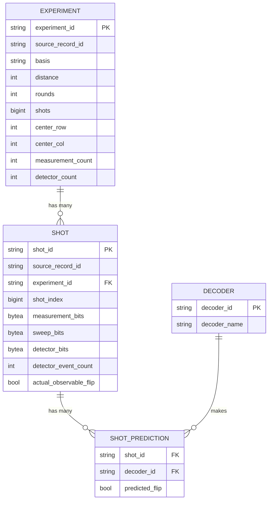

# Part 1

## Gold table definitions

### Gold Design
1. google_qec gold relation (see ER diagram):

Since each experiment has a shot related to it, it was decided to connect each individual experiment (google experiment) with its shot (Google shots). The google experiment table is left untouched and its experiment_id is used as FK in the shot table. 

For each shot it is also known what the four decoders have predicted in that particular shot. To prevent redundancy and stimulate clarity, it was decided to give the prediction its own table. This table contains the four decoders. 
The table that connect **decoder** table with **shot** table is the **shot_prediction** table. It uses the shot_id from the **shot** table and decoder_id from the **decoder** table to access each individual prediction for that particular combination of the shot_id and decoder.
This design choice implies a trade-off of an additional join across 2 extra tables instead of writing one row. However, this makes a cross-comparison for decoders far simpler, and in case and additional decoder needs to be added, all the tables (except **decoder**) remain unchanged.

## architecture

### The pipeline and data flow

The architecture used is aligned with the with the quantum_lake_student stages.
When running the pipeline, everything starts in cli.py. The bronze sources are being fetched from the MinIO, which are being verified (register_sources.py). After the data sources have been verified, the run proceeds to the second and also biggest stage, which implies cleaning and generating silver schema for all three bronze resources. This happens in prepare_data.py, where all the required data is being extracted from the bronze sources, checked for consistency, and appended into the corresponding silver stage table. In addition to that a shared tracing table is generated as well, covering the mapping of every Silver table back to bronze. Upon completion of all the 6 silver tables, the golden schema is getting generated in the load_postgres.py stage, where the tables are being generated (with keys, constraints, and indexes) and filled in with the data from the silver stage. 

### Source discovery - Google qec 
The google_surface_code contains of 5 directories, with each individual one having properties.yml, a metadata file corresponding with the google experiment tables for the Silver stage. 

Each experiment row is identified by **experiment_id** and a **source_record_id** which links back to its properties.yml file. Every row represent an experiment in a particular chip region (center row/col), how for a particular measurement (basis) and error protection (code distance) measurement cycle was performed for how many runs (shots) And within that shot how many times (rounds) the cycle was performed. it also records the number of raw readout bits per shot (measurement_count) and the final count of detector-event bits per shot (detector_count).

Each experiment has many shots, implying one-to-many relationship used in the Gold schema.

### Source discovery - Syndrome

### Source discovery - QASMBench

## sample trace

### Google_experiment

A trace proves reproducibility, showing that any ML example can be followed back to its original record
An example of the google_experiment trace can be found in trace_examples.json. It is generated by build_trace_examples.py and performs a full ML->Gold->Silver->Bronze trace check.

**ML**: In the ML view, a row is selected, matching the experiment_id and shot_index, giving example_id and shot_id.

**Gold**: gold_shot is being read based on shot_id from the ML stage, which includes source_record_id, linking back to Silver and Bronze stage. The experiment row is read using experiment_id of the shot, which has its own source_record_id. Also, each individual prediction is fetched based on shot_id. 

**Silver**: The experiment and shot parquet tables are being filtered based on the source_record_id from the golden schema of experiment and shot rows. 

**Bronze**: For Bronze, the same source_record_id value is used to find the corresponding rows in the shared source trace table

### Syndrome

An example for syndrome trace can be found in the same file.

**ML**: Based on the physical_fault_rate, we select an example row from ML view, which gives example_id and source_record_id.

**Gold**: For the corresponding source_record_id, the syndrome observation is read which contains pattern_id for the syndrome pattern row. Experiment_id is also used to select the row from the Experiment table.

**Silver & Bronze**: Tables are being filtered on the same source_record_id.

This shows the desired trace, by explicitly extracting the keys and foreign keys.

## Quality findings 

results/part1/row_counts.json reports for the experiment and shot table the read/accepted/rejected row counts. Before that, any corrupted or incomplete experiment folder would be silently accepted. After the fix, any missing or incomplete file is correctly excluded, counted and rejected, which corresponds with the reflected number in row_counts.json. Any discrepancies are written into data_issues.parquet

Here are the overall counts for each of the 6 tables

| Table | Read | Accepted | Rejected |
|---|---|---|---|
| experiment | 5 | 5 | 0 |
| shot | 250,000 | 250,000 | 0 |
| syndrome_observation | 75,598 | 75,598 | 0 |
| circuit | 6 | 6 | 0 |
| stabilizer_check | 4 | 4 | 0 |
| conditional_correction | 6 | 6 | 0 |
| **Gold load (total)** | 325,619 | 325,619 | 0 |

## command to run

The whole pipeline can be cleanly run with the following commands. 
1. make bootstrap: make the container where the pipeline will be ran
2. make train: The actual pipeline. 
3. make test: executes automated tests in the /tests folder

## Testing

Different tests were written to ensure quality of the data.
In the tests folder, various tests python folders can be found, covering all silver tables. For example, the test_google_experiment.py covers: valid experiment, broken input, repeatability and multiple experiments.

## Troubleshooting
 
## AI-usage

AI was mostly used for assistance in the understanding of the assignment. Specifically what each table and source represents, the structure of the data and the flow and requirements from the assignment. 

## SQL analysis 